<picture>
  <source media="(prefers-color-scheme: dark)" srcset="dark_mode.svg">
  <source media="(prefers-color-scheme: light)" srcset="light_mode.svg">
  
</picture>

## 👋 About Me

Hi, I'm **Farras**, a Computer Engineering student at **BINUS University** (Jakarta) who likes understanding how things work from the transistor up to the software on top, and making them look good along the way.

- 🎯 Aiming to become an **AI engineer** with a hardware-aware mindset
- ⚡ Building with **electronics, microcontrollers, and analog circuits**
- 🎨 Designing interfaces, graphics, and motion in **Figma, Adobe, and Affinity**
- 🌐 Starting a small venture with friends, building **websites for small businesses**

## 🌐 Socials

## 💻 Tech Stack

**Languages** 

**Web & Backend** 

**Design** 

**Tools & Hardware** 

---

card is auto-generated by <code>generate.py</code> · stats refresh daily via GitHub Actions

